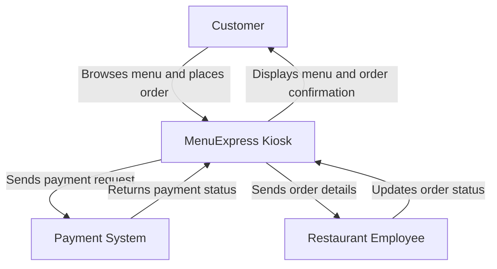

# Capstone-Project

# Member Name: Robert Schementi
# Member Name: Patrick Cortez
# Member Name: Koby Gryciuk
# Member Name: Johann Johnson
# Member Name: Daniel Pineda
# Member Name: Gurjot Ghotra

# Capstone Project

* MenuExpress Kiosk: It would be an in-store kiosk where people would browse through the menu and can customize their meal. They can pay with their card or with their phone.

## Prototype

The MenuExpress Kiosk app prototype was designed using Figma. It includes an opening screen, login screen, home screen, and ordering menu.

Figma Public Link: https://www.figma.com/design/LqC3kiaKIfZnWszWDx9Czf/Capstone-project-prototype?node-id=0-1&t=HBw6y6CMUdaugPFm-1 

### User Personas

Persona 1: Alex – Primary User (Customer)

Alex is a 22-year-old college student who wants to order food quickly between classes. He prefers using a digital menu instead of waiting in line.

* Goal: Browse the menu, customize his burger, and pay quickly.
* Frustration: Long lines and complicated ordering systems.
* Needs: A simple interface with clear prices, pictures, and customization options.

Persona 2: Sarah – Secondary User (Restaurant Employee)

Sarah is a 28-year-old restaurant employee responsible for preparing customer orders.

* Goal: Receive accurate orders and prepare food efficiently.
* Frustration: Incorrect orders and unclear customization requests.
* Needs: An organized system that clearly displays customer selections and special instructions.

### Context Diagram

### UX Workflow – Customer Ordering Food

The primary user is a customer who wants to order food quickly using the MenuExpress Kiosk.

1. The customer opens the application and sees the welcome screen.
2. The customer signs in to their account.
3. The customer arrives at the home screen.
4. The customer selects the ordering menu.
5. The customer browses burgers, chicken, sides, drinks, and combos.
6. The customer selects a food item and customizes the order.
7. The customer adds the item to the cart and reviews the order.
8. The customer pays using a card or mobile payment.
9. The system confirms the order and sends it to the restaurant staff.

User Goal: Make ordering food faster, easier, and more convenient.

## Architecture

MenuExpress Kiosk is a proposed food-ordering application designed to make ordering meals faster and easier.

### Frontend

The user interface will allow customers to sign in, browse menu items, customize orders, and complete checkout. The interface is currently being designed and prototyped using Figma.

### Backend

The backend will handle customer accounts, menu information, order processing, and communication between the application and the database. Node.js and Express.js are proposed for backend development.

### Database

MongoDB is planned to store customer account information, menu items, orders, and order history.

## Test Plan

The MenuExpress Kiosk application will be tested to make sure it works correctly and provides a smooth ordering experience.

1. Unit Testing

Unit testing will check individual functions of the application to make sure they work correctly.

Examples:

* Verify that the quantity increases when a customer presses the plus button.
* Check that the total price is calculated correctly.
* Verify that menu items display the correct prices.

2. Integration Testing

Integration testing will check whether different parts of the application work together correctly.

Examples:

* Verify that items selected from the menu appear correctly in the shopping cart.
* Check that customer order information is sent to the backend.
* Verify that orders are stored correctly in MongoDB.

Testing Goal

The goal is to identify errors, ensure accurate orders, and provide customers with a reliable ordering experience.
